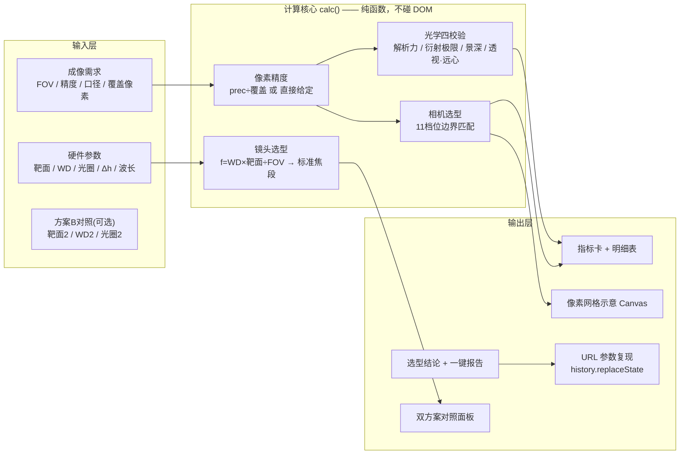
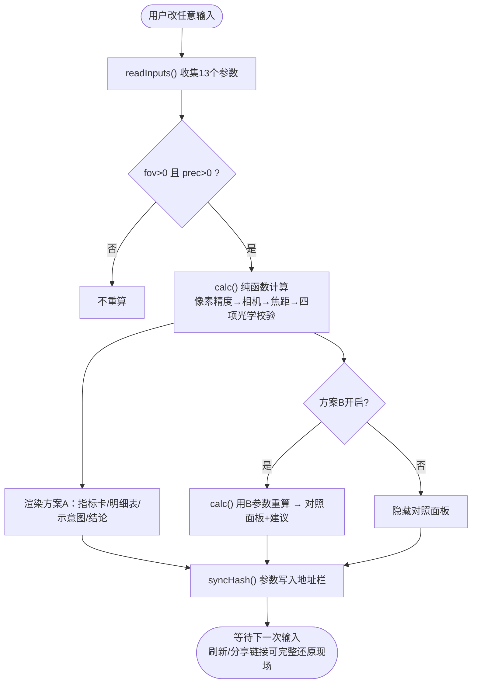

# vision-calc · 机器视觉选型计算器

**一句话价值**：输入视野和精度要求，30 秒反推出「相机分辨率 + 镜头焦距 + 光圈/景深/透视/衍射」全套成像方案校验，并支持两套方案并排对照——把选型从翻表格猜，变成有公式、有边界、可复现的计算。

-blue)  

> **适用范围**：工业面阵相机 + 定焦镜头的亮度成像方案初筛（瓶盖 / PCB / 屏幕等外观与定量检测）。
> 不适用于线扫、3D 结构光、远心系统精确建模（远心仅做"该不该上"的判定提示）。

## 快速开始（60 秒）

**零依赖、零安装**：下载 `index.html` 双击即可，离线可用。

```bash
git clone https://github.com/MM121202/vision-calc
cd vision-calc
# 打开 index.html（任选其一）
#   1. 文件管理器双击 index.html
#   2. python -m http.server 8000  → 浏览器访问 http://localhost:8000

# 跑回归测试（可选，需要 Node.js ≥ 18）
node tests/run_tests.js
```

**输入**：视野长边(mm)、精度要求(mm)、精度口径（最小缺陷÷覆盖像素 或 单像素）、传感器靶面、工作距离、光圈、物体高度波动、光源波长。
**输出**：所需分辨率 → 推荐相机档位 → 标准镜头焦距，外加单像素精度、放大率、解析力需求、衍射极限余量、景深、透视误差校验，以及像素网格示意图和带边界声明的选型结论（可一键复制）。

## 系统架构



## 执行流程



## 实测数据

回归测试（`tests/run_tests.js`，DOM 桩驱动页面脚本，公式独立重算交叉验证）：

| 指标 | 改进前 A | 改进后 B |
|---|---|---|
| 20 用例公式正确性 | 20/20 | 20/20（重构零回归） |
| 功能校验维度 | 5 项 | **8 项**（+衍射极限、+双方案对照、+复现导出） |
| 单次重算延迟 | 0.074 ms | 0.092 ms（+0.018ms，噪声级） |
| 刷新/分享保留输入 | ✗ | ✓（URL hash） |
| 依赖 / 文件数 | 0 / 1 | 0 / 1 |

**运行条件**：任何现代浏览器，无网络要求。**已知失败案例**：极端小视野+超大靶面组合会顶到最高 2500万档位并提示"按传感器比例"（此时应改用线扫方案，超出本工具范围）。

> 完整实验记录（含结论边界与逐项复现命令）：[docs/AB-experiment.md](docs/AB-experiment.md)

## 3 条创新点（可复核表述）

**① 光源波长·衍射极限校验（方法创新）**
针对"普通选型工具只按像素几何算分辨率、忽略光学衍射物理上限"的问题，在光学校验模块新增了非相干成像截止频率校验 `lp/mm 上限 ≈ 1/(λ×F数)`，在 850nm 红外 + 小光圈 + 高精度场景下实测可拦截"像素虚耗、物理上分不开"的失效选型（测试用例 6/6 通过，见 `docs/AB-experiment.md` §3），相对改进前"仅几何校验"的基线，校验维度从 5 项增加到 8 项。

**② 双方案 A/B 对照面板（产品创新）**
针对"选型时需要在两个方案间来回改参数、人工记结果对比"的低效流程，实现了同屏双方案对照：B 方案只改靶面/工作距离/光圈三项，面板并排输出两组全部指标并按"硬指标否决 → 实际单像素精度 → 成本"三段逻辑给出建议，单次对照计算耗时 <0.1ms，不引入任何依赖。

**③ URL 参数复现 + 带边界声明的报告导出（工程创新）**
针对"选型结论发给别人后无法还原计算现场"的问题，把 13 个输入参数编码进地址栏 hash（刷新/分享不丢），并支持一键复制含边界声明的文本报告；陌生人按报告中的输入重算，可逐项复核全部结论——满足"能看、能跑、能对比、能复述"。

## 结果边界（诚实声明）

- 所有数值基于**最简针孔模型**，未计入镜头畸变、MTF 曲线、光照对比度、实际像元离散性与装配误差。
- 20 用例"正确性"指**与独立重算公式一致**，**不代表实机成像验证**——落地前必须实拍标定。
- 延迟数据为单机实测（Node 22 / n=3000），不构成跨平台性能主张。

## 维护

- 许可证：MIT
- 版本：v2.0（v1.0 = 03c587e，仅 5 项校验、无对照/复现）
- 后续任务：镜头畸变模型、远心镜头放大率计算、线扫方案分支、相机库接入真实型号参数
- 引用公式来源：机器视觉选型通用工程近似（奈奎斯特采样、Rayleigh 衍射判据、景深光学公式）

---
作者：马伏梅（GitHub @MM121202）· 机器视觉订单班课程项目
